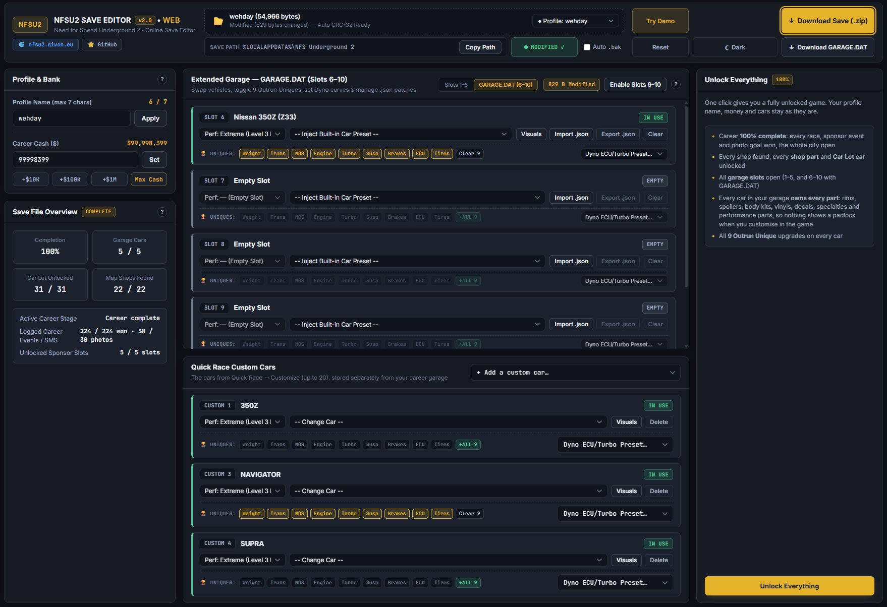

# NFS Underground 2 — Save Editor (Web)

Browser-based utility for editing **Need for Speed: Underground 2** career save files & extended `GARAGE.DAT` files. All file parsing and modifications happen locally in your browser - saves are never uploaded to any server.

## Web Version
- **Live Editor:** [nfsu2.divon.eu](https://nfsu2.divon.eu/)
- **Guides & Documentation:** [nfsu2.divon.eu/guides/](https://nfsu2.divon.eu/guides/)

## Features (v2.0)
- **Profile, Cash & Native `.ZIP` Support:**
  - Rename your career profile (up to 7 ASCII characters) and edit your bank balance.
  - Direct support for exported `.zip` save archives (switch between multiple profiles inside the archive and download a ready-to-restore `.zip`). The GARAGE.DAT fingerprint is updated with your edits, so nfsu2-web keeps slots 6–10.
- **Career Garage (Slots 1–5) & GARAGE.DAT (Slots 6–10):**
  - Unlock all 5 career garage slots at any point in the game without affecting active map races.
  - Full support for external `GARAGE.DAT` files (Slots 6–10 used by `nfsu2.xyz` and Extra Options).
- **Performance, Outrun Uniques & Dyno:**
  - Switch any car between *Stock*, *Street (Lvl 1)*, *Pro (Lvl 2)*, and *Extreme (Lvl 3)* tuning levels.
  - Toggle all **9 Outrun Unique upgrades** (*Weight, Trans, NOS, Engine, Turbo, Susp, Brakes, ECU, Tires*) individually per car.
  - Apply quick **Dyno ECU/Turbo presets** (*Peak Horsepower*, *Drag Acceleration*, *Drift Torque*, or *Reset to Stock*).
- **40+ Built-in Car Presets:**
  - Story & Sponsor vehicles (*Rachel's 350Z*, *Caleb's GTO*, *Nikki's Mustang*, *Snoop Dogg's Escalade*, *Capone's H2*).
  - Custom Rivals, Player Builds, EU/US regional exclusives (*Peugeot 106*, *Opel Corsa*, *Honda Civic Si*, *Acura RSX*), and all 26 stock career cars.
- **Unlock Everything (one button):**
  - Completes the career from the game's own goals (all 224 events, 30 photo goals, every stage), so the game itself shows 100%; every shop, shop part and Car Lot car is unlocked and every garage slot (1–10) is open.
  - Every car in your garage owns every part (rims, spoilers, body kits, vinyls, decals, specialties, performance parts) and all 9 Outrun Uniques, so nothing is padlocked when you customise in the game's garage.
  - Keeps your profile name, money and cars. Works without any game files.
- **JSON Car Patches & Checksums:**
  - Export and import individual car builds as `.json` files.
  - Automatic header CRC-32 recalculation on save download.

## Backup Note
Always keep a backup of your original save files before editing (you can also enable the **Auto `.bak`** checkbox in the top bar).

## Guides
- [NFSU2 Save File Location (Windows 10/11 & Web Port)](https://nfsu2.divon.eu/guides/nfsu2-save-file-location/)
- [How to Get Rachel's 350Z & Boss Cars in Career Mode](https://nfsu2.divon.eu/guides/rachel-350z-nfsu2/)
- [Outrun Unique Parts & Stage 3 Performance Guide](https://nfsu2.divon.eu/guides/nfsu2-outrun-unique-parts/)
- [5–10 Slot Garage & GARAGE.DAT Editor Guide](https://nfsu2.divon.eu/guides/nfsu2-garage-dat-editor/)
- [NFSU2 Online Money Trainer Guide](https://nfsu2.divon.eu/guides/nfsu2-money-trainer/)
- [NFS Underground 2 PC Cheat Codes](https://nfsu2.divon.eu/guides/nfsu2-cheat-codes-pc/)

## Save File Location (Windows)
Press `Win + R` and paste:
`%LOCALAPPDATA%\NFS Underground 2`
*(See the [Save File Location Guide](https://nfsu2.divon.eu/guides/nfsu2-save-file-location/) for `nfsu2.xyz` `.zip` export and restore steps).*

## Running Locally
1. **Web App (PWA):** Open [nfsu2.divon.eu](https://nfsu2.divon.eu/) and install it via your browser's address bar for offline access.
2. **From Archive / Repository:**
   - Download the latest `.zip` from [Releases](https://github.com/Starladdey/nfsu2-save-editor/releases) or clone this repository.
   - Open `index.html` in your browser to load and edit local save files.
   - *Tests:* `node --test tests/*.test.mjs` (no dependencies). Career tests also need the game data: `NFSU2_GAMEDATA=/path/to/GLOBAL/GlobalB.lzc node --test tests/*.test.mjs`.
   - *Note:* To use the `Try Demo`, button locally, run a local HTTP server in the project folder (for example, `npx serve` or `python -m http.server 8000`), as browsers block `fetch()` requests over `file://`.

## Credits & Disclaimer
- [NFSU2 Save File Technical Documentation](https://github.com/hackch/NFSU2-Savegame-Editor/blob/main/technical.md)
  - Technical research on save file structure and decryption.
- [hackch/NFSU2-Savegame-Editor](https://github.com/hackch/NFSU2-Savegame-Editor) (MIT, © 2025 Christopher Hack)
  - The `GLOBALB.BUN` part-database reader and visual-slot rules in `js/visual-editor.js`, and the career completion in `js/career.js`, are adapted from this project.
- Special thanks to players on r/NFSU2 for testing and feedback.

Unofficial non-commercial fan project. Not affiliated with, endorsed, or sponsored by Electronic Arts Inc. (EA).